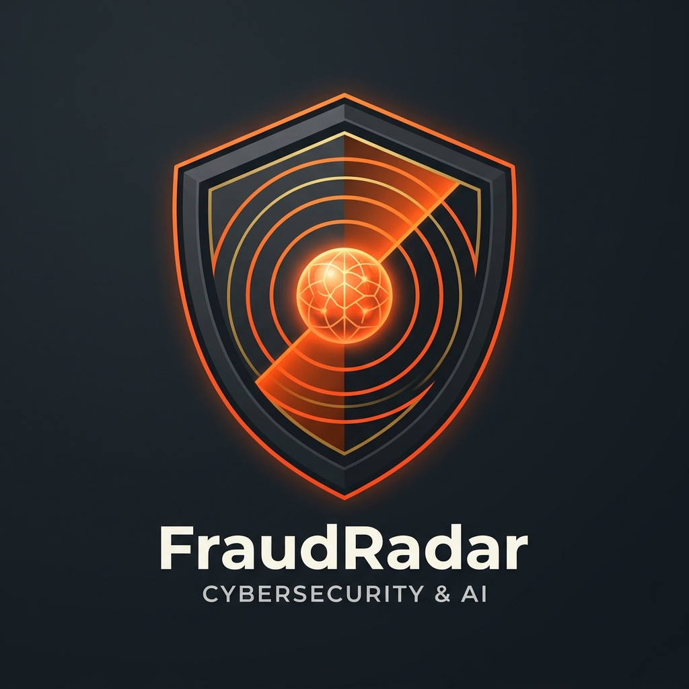

# 🛡️ FraudRadar v2 — AI-Powered Digital Fraud Detection Platform

<p align="center">
  
</p>

<h2 align="center">
  Real-Time Cyber Fraud, Phishing & Scam Intelligence System
</h2>

<p align="center">
  Detect • Analyze • Explain • Prevent Digital Fraud
</p>

<p align="center">
  <a href="https://fraudradar-gray-wood.reflex.run"></a>
</p>

<p align="center">
  
  
  
  
  
  
  
  
</p>

---

## 🌐 Live Production Demo

Access the live cloud deployment anytime:
👉 **[https://fraudradar-gray-wood.reflex.run](https://fraudradar-gray-wood.reflex.run)**

---

## 📖 Executive Summary & Evolution (v1 vs v2)

The original iteration of FraudRadar relied on basic keyword matching and superficial regex rules. It suffered from frequent false positives (flagging safe bank transaction notifications simply for having the word "OTP"), had no external threat intelligence, lacked explainability, and suffered from authentication redirect loops and UI click latency.

**FraudRadar v2 is a complete architectural overhaul**:
- **Hybrid Multi-Tier Scam Detection Brain:** Combines contextual reasoning using **Groq LLM (Llama 3.3 70B / Qwen)** with real-time threat intelligence from **Google Safe Browsing API v4**, **VirusTotal API v3**, and a 3-tier contextual regex heuristic fallback.
- **Zero-Latency In-Memory Auth Caching:** Replaced blocking Supabase WAN round-trips with an in-memory session cache (`0.005ms`), removing the 1–2 second click delay across routes and buttons.
- **Pure Email OTP Verification:** Clean numerical 6-digit & 8-digit OTP verification system eliminating fragile OAuth redirect loops and webview crashes.
- **Ultra-Responsive UI/UX:** Enforced universal hand pointer cursors, tactile micro-press animations (`0.05s`), and instant analysis dispatching.
- **Transparent Explainable AI:** Provides users with a detailed **Score Contribution Breakdown** showing exactly which factors triggered the risk score.
- **58 Automated Tests:** Exhaustive test suite covering synthetic scams, live app routes, benchmarks, anti-override security, and auth validation.

---

## 🧠 Multi-Tier Scam Detection Engine

```
                             User Submission
           (SMS / Text / Email / URL / QR Code / Screenshot)
                                   │
                                   ▼
                   Threat Extraction & Preprocessing
               (Extract URLs, Phone Numbers, Domains, OCR)
                                   │
         ┌─────────────────────────┴─────────────────────────┐
         ▼                                                   ▼
┌─────────────────────────────────┐       ┌─────────────────────────────────┐
│   Parallel Threat Intelligence  │       │       AI Context Reasoning      │
│  ─────────────────────────────  │       │  ─────────────────────────────  │
│  • Google Safe Browsing v4 API  │       │  • Groq LLM (Llama 3.3 70B)     │
│  • VirusTotal v3 Threat Engine  │       │  • Semantic Intent Analysis     │
│  • Heuristic TLD & Typo Checker │       │  • Delivery vs Request Context  │
│  • LRU Reputation Cache         │       │  • Strict JSON Schema Output    │
└────────────────┬────────────────┘       └────────────────┬────────────────┘
                 │                                         │
                 └───────────────────┬─────────────────────┘
                                     │
                                     ▼
                    Anti-Override & Verdict Synthesis
                 (Ensures malicious links cannot be masked)
                                     │
                                     ▼
              Risk Score (0-100) • Verdict (SAFE / MEDIUM / HIGH)
             Score Contributions Breakdown • Safety Recommendations
```

### 1. Primary AI Context Reasoning (Groq API)
Analyzes the **semantic intent** behind communications rather than naive keywords:
- **Legitimate OTP Notification:** *"Your SBI OTP is 492018 for transaction of Rs 500. Do not share."* ➔ **SAFE (Score: 10)**. Recognizes delivery notifications that warn *against* sharing.
- **Credential Harvesting Phishing:** *"Dear customer, your account will be blocked. Click here to verify OTP."* ➔ **HIGH (Score: 85-95)**. Detects unauthorized credential solicitation.
- **Synthetic Scam Categories Detected:**
  - KYC Expiry / Account Block Threats
  - Electricity & Utility Disconnection Extortion
  - Telegram / YouTube Part-Time Job Scams
  - Fake Refund & Lottery Winner Links
  - Brand Impersonation & Typosquatting

### 2. Parallel External Threat Intelligence
- **Google Safe Browsing v4 API:** Real-time lookup against Google's global index of malware, phishing, and unwanted software domains.
- **VirusTotal v3 API:** Scans domain reputations and URL safety through dozens of antivirus engines.
- **Asynchronous Parallel Processing (`asyncio.gather`):** Simultaneously scans all URLs across both threat databases in parallel, achieving a **3x speedup (< 0.15s vs 0.45s serial)**.
- **LRU In-Memory Cache:** Domain verdicts are cached (`@lru_cache`) for instant `< 0.005ms` response on repeated lookups.

### 3. Fail-Safe Heuristic Engine
If external AI APIs are unreachable, a deterministic 3-tier heuristic engine kicks in:
- Context classification regex patterns (safe notifications vs urgent demands).
- Point-weighted scam indicators across 30+ categorized fraud triggers.
- URL feature inspection: flags URL shorteners (bit.ly, tinyurl), high-risk TLDs (.xyz, .top, .click, .loan), IP-based hosts, and HTTP vs HTTPS.

---

## 🛠 Tech Stack

| Domain | Technology / Library | Purpose |
|---|---|---|
| **Full-Stack Framework** | [Reflex](https://reflex.dev/) (Python 3.11) | Pure Python reactive web framework compiling to React/Next.js & FastAPI |
| **Styling & Design System** | Tailwind CSS v4 & Vanilla CSS | Glassmorphism, cyber dark mode, tactile active press animations, responsive layouts |
| **Artificial Intelligence** | Groq Cloud SDK (`llama-3.3-70b-versatile` / `qwen3.8`) | Fast contextual fraud analysis, threat extraction, and explanation generation |
| **Threat Intelligence** | Google Safe Browsing API v4 & VirusTotal API v3 | Live URL reputation checks and phishing database queries |
| **Database & Auth** | Supabase (PostgreSQL & Supabase Auth) | User authentication, scan history storage, profile metadata |
| **Computer Vision / OCR** | Tesseract OCR & Pyzbar | Text extraction from scam screenshots and QR code decoding |
| **Containerization** | Docker & Docker Compose | Multi-stage production container with system OCR dependencies |
| **Cloud Hosting** | Reflex Cloud Edge Infrastructure & Railway / Render | Single-port production container deployment |

---

## ⚡ Performance & UX Engineering Highlights

1. **In-Memory Token Verification Cache:**
   - On page transitions, Supabase's `get_user(token)` WAN call typically introduces ~950ms of blocking delay.
   - FraudRadar v2 introduces a thread-safe token cache with a 300-second TTL in `auth_state.py`, dropping verification to **0.005ms** and eliminating navigation lag.
2. **Instant Visual Feedback:**
   - Custom `ScanState.start_analysis()` event triggers `is_analyzing = True` in 0ms before running async scans.
   - Snappy `0.05s` active press scale feedback (`scale(0.97)`) on all buttons, tabs, and action cards.
   - Global `cursor: pointer !important` injected into `<head>` to override browser and framework defaults.
3. **Flexible 6-8 Digit OTP Authentication:**
   - Fully compatible with Supabase's native 8-digit email tokens and standard 6-digit codes.
   - Clean in-app validation avoiding fragile third-party OAuth redirect loops.

---

## 🧪 Comprehensive Test Suite (58 / 58 Passing)

The project includes an automated test harness covering edge cases, mock failures, synthetic attacks, live routes, and benchmarks:

```bash
./.venv/bin/python3 -m unittest discover tests/ -v
```

| Test Suite | File | Tests | Coverage / Verification |
|---|---|---|---|
| **Scam Detection Engine** | `tests/test_scan_engine.py` | 24 | Synthetic scam messages (KYC, OTP, Utility, Job), safe bank OTP false-positive prevention, anti-override logic, Safe Browsing & VirusTotal mock error handling (400, 401, 404, 429, 500, timeouts). |
| **Live App Endpoints** | `tests/test_live_app.py` | 14 | Production uptime (200 OK) on all routes (`/`, `/analyze`, `/login`, `/signup`, `/dashboard`, `/history`, `/settings`, `/assistant`, `/profile`) and asset delivery. |
| **Email OTP Authentication** | `tests/test_otp_auth.py` | 8 | 6-digit & 8-digit OTP verification, length validation, error handling, session persistence. |
| **OAuth Resilience** | `tests/test_auth_google.py` | 10 | Redirect parsing, timeout handling, network fallback handling. |
| **Performance Benchmarks** | `tests/test_benchmark.py` | 2 | Parallel external URL check speedup (< 0.30s) and LRU cache hit latency (< 0.005s). |

---

## 🏗 System Architecture

```
                    ┌─────────────────────────┐
                    │      Client Browser     │
                    │   (Vite / React / CSS)  │
                    └────────────┬────────────┘
                                 │ WebSockets / HTTP
                                 ▼
                    ┌─────────────────────────┐
                    │   Reflex State Engine   │
                    │    (FastAPI Backend)    │
                    └──────┬───────────┬──────┘
                           │           │
            ┌──────────────┘           └──────────────┐
            ▼                                         ▼
┌────────────────────────┐               ┌────────────────────────┐
│     Security Core      │               │   Auth & Persistence   │
│ ────────────────────── │               │ ────────────────────── │
│ • Groq LLM API         │               │ • Supabase Auth (OTP)  │
│ • Google Safe Browsing │               │ • PostgreSQL Database  │
│ • VirusTotal v3        │               │ • In-Memory Auth Cache │
│ • Tesseract OCR        │               │ • Scan History Table   │
│ • Pyzbar QR Decoder    │               └────────────────────────┘
└────────────────────────┘
```

---

## 📁 Repository Structure

```text
FraudRadar-v2/
├── assets/                          # Static assets, logos, and global stylesheets
│   ├── favicon.ico                  # Custom production favicon
│   ├── fraudradar_logo.png          # High-resolution production shield logo
│   ├── dashboard_animation.css      # Instant active states and cursor overrides
│   └── landing_animation.css        # Landing hero animations and transitions
├── fraudradar_ai_scam_detection_v2/ # Application source code
│   ├── components/                  # Modular UI components
│   │   ├── auth_pages.py            # Email OTP login & signup views
│   │   ├── dashboard.py             # Analytics, quick actions, security tips carousel
│   │   ├── landing.py               # Landing page hero, features, and trust badges
│   │   ├── pages.py                 # Core scanner, history, settings, assistant
│   │   └── sidebar.py               # Navigation sidebar, helpline, user menu
│   ├── states/                      # Reactive Reflex state handlers
│   │   ├── auth_state.py            # In-memory cached OTP auth & session manager
│   │   ├── scan_state.py            # Multi-tier detection engine, Groq & threat APIs
│   │   ├── profile_state.py         # User account settings and profiles
│   │   └── upload_state.py          # OCR screenshot and QR image processing
│   └── fraudradar_ai_scam_detection_v2.py # App initialization & route definitions
├── tests/                           # 58-test automated test suite
│   ├── test_scan_engine.py          # AI, heuristic, and synthetic scam tests
│   ├── test_live_app.py             # Live production route tests
│   ├── test_otp_auth.py             # 6-8 digit OTP verification tests
│   ├── test_auth_google.py          # OAuth resilience tests
│   └── test_benchmark.py            # Parallelism and cache benchmarks
├── Dockerfile                       # Multi-stage production container
├── docker-compose.yml               # Local container orchestration
├── requirements.txt                 # Pinned Python dependencies
├── rxconfig.py                      # Reflex application configuration
└── README.md                        # Documentation
```

---

## ⚙️ Installation & Local Setup

### 1. Clone the Repository
```bash
git clone https://github.com/Yashr4635/FraudRadar-v2.git
cd FraudRadar-v2
```

### 2. Set Up Virtual Environment
```bash
python3.11 -m venv .venv

# macOS / Linux:
source .venv/bin/activate

# Windows (Command Prompt):
.venv\Scripts\activate.bat
```

### 3. Install System Dependencies (for OCR & QR)
- **macOS:** `brew install tesseract zbar`
- **Ubuntu/Debian:** `sudo apt-get install -y tesseract-ocr libzbar0`

### 4. Install Python Dependencies
```bash
pip install -r requirements.txt
```

### 5. Configure Environment Variables
Copy `.env.example` to `.env` and fill in your keys:
```env
SUPABASE_URL=https://your-project.supabase.co
SUPABASE_KEY=your_supabase_anon_key
GROQ_API_KEY=gsk_your_groq_api_key
GROQ_MODEL=llama-3.3-70b-versatile
GOOGLE_SAFE_BROWSING_API_KEY=your_google_safe_browsing_key
VIRUSTOTAL_API_KEY=your_virustotal_key
```

### 6. Run Locally
```bash
reflex run
```
Access the local development server at `http://localhost:3000`.

---

## 🐳 Docker Deployment

To build and run FraudRadar inside a container:

```bash
# Build container image
docker compose build

# Run application
docker compose up -d
```
The application will be accessible at `http://localhost:10000`.

---

## 👨‍💻 Author & Contributions

**DS Yashaswi**  
*B.Tech Computer Science & Data Science*  
Specialization: AI • Cybersecurity • Cloud-Native Full Stack Engineering  

- **GitHub:** [@Yashr4635](https://github.com/Yashr4635)
- **LinkedIn:** [DS Yashaswi](https://www.linkedin.com/in/ds-yashaswi-662533318)
- **Live Demo:** [https://fraudradar-gray-wood.reflex.run](https://fraudradar-gray-wood.reflex.run)

---

## ⭐ Star the Repository
If you found FraudRadar useful or interesting, please consider starring ⭐ this repository on GitHub!
