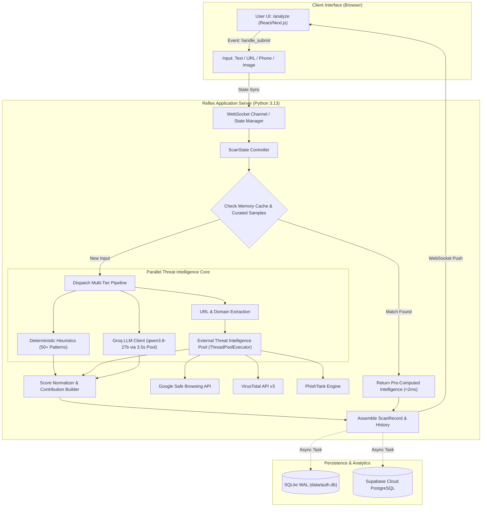

# FRAUDRADAR-V2: TECHNOLOGY STACK & SYSTEM ARCHITECTURE SPECIFICATION

**Document Version**: 2.4.0  
**Target Environment**: Production (Reflex Cloud / Fly.io Container Infrastructure)  
**Repository Directory**: `/Users/apple/Desktop/FraudRadar-v2`  

---

## 1. COMPLETE TECHNOLOGY STACK WITH VERSIONS

The following table reflects the exact runtime dependencies verified from `requirements.txt`, Python virtual environment inspection (`.venv`), and container deployment configurations:

| Component / Layer | Technology | Exact Version | Why It Is Used | File References & Responsibilities |
| :--- | :--- | :--- | :--- | :--- |
| **Core Framework** | Reflex (Pure Python Fullstack) | `0.9.6.post1` | Eliminates language boundary between frontend and backend; compiles Python code directly into React/Next.js and FastAPI/Starlette endpoints. | `rxconfig.py`, `fraudradar_ai_scam_detection_v2.py` |
| **Runtime Language** | Python | `3.13.16` | Modern asynchronous programming (`asyncio`), robust typing (`typing.TypedDict`), and strong cryptography support. | Global runtime across all modules |
| **ASGI Server** | Granian / Starlette | `2.7.7` / `1.3.1` | Ultra-high performance Rust-based ASGI server powering Reflex's backend HTTP and WebSocket communication. | Embedded in Reflex runtime |
| **Frontend Compiler** | Next.js / React | `14.x` / `18.x` | Automatically emitted by Reflex into `.web/` directory. Provides client-side rendering, hydration, and instant DOM updates. | `.web/` build artifacts |
| **UI Styling** | Tailwind CSS v4 & Radix UI | Radix `0.9.5` | Modern utility-first styling with accessible UI primitives (modals, accordions, tooltips, dialogs). | `rxconfig.py`, `components/pages.py` |
| **LLM Inference Provider** | Groq Python SDK | `1.5.0` | Ultra-low latency LPU (Language Processing Unit) cloud API delivering sub-second completions for open-weights models. | `services/scan_state.py`, `states/assistant_state.py` |
| **Target LLM Model** | Qwen 3.8 (27B Parameters) | `qwen/qwen3.8-27b` | Open-weights multilingual model with high accuracy on instruction following and JSON-schema structured output. | `scan_state.py:1329` |
| **Assistant Model** | GPT-OSS 120B (Groq) | `openai/gpt-oss-120b` | Conversational cybersecurity assistant providing 24/7 advisory on Indian cyber crime prevention. | `assistant_state.py:13` |
| **Database (Embedded)** | SQLite 3 (WAL Mode) | System / `3.43+` | Zero-configuration ACID database with Write-Ahead Logging for high concurrency without locks. | `services/auth_db.py`, `data/auth.db` |
| **Database (Cloud)** | PostgreSQL / Supabase | `psycopg 3.3.4` | Relational cloud database for persistent user records, scan history, and delivery audit logs across restarts. | `services/auth_db.py:31-45` |
| **Token Authentication** | PyJWT | `2.13.0` | Generates and verifies cryptographically signed HS256 tokens for authenticated user sessions. | `services/otp_service.py:7`, `states/auth_state.py` |
| **Password Cryptography** | `hashlib` / `hmac` / `secrets` | Standard Library | Implements PBKDF2-HMAC-SHA256 with 100,000 iterations for password hashing and HMAC-SHA256 for OTP verification. | `services/auth_db.py`, `services/otp_service.py` |
| **HTTP Transport** | HTTPX | `0.28.1` | Asynchronous and synchronous HTTP client with connection pooling, keep-alive, and strict timeouts. | `states/scan_state.py:37`, `tests/test_scan_engine.py` |
| **OCR & Image Parsing** | PyTesseract & Pillow | `0.3.13` / `12.2.0` | Extracts optical text from uploaded screenshots of SMS, WhatsApp messages, or phishing emails. | `states/upload_state.py` |
| **QR Code Decoding** | PyZbar | `0.1.9` | Decodes QR code payloads to inspect underlying UPI links or malicious redirect URLs. | `states/upload_state.py` |
| **Email Transport** | Python `smtplib` / `ssl` | Standard Library | Direct STARTTLS SMTP delivery to Google Mail servers (`smtp.gmail.com:587`). | `services/email_service.py:480-550` |

---

## 2. HIGH-LEVEL ARCHITECTURAL FLOW DIAGRAM



---

## 3. MAIN APPLICATION MODULES & RESPONSIBILITIES

### 3.1 Module Directory Breakdown

```
fraudradar_ai_scam_detection_v2/
├── components/                     # User interface component definitions
│   ├── auth_callback.py            # OAuth callback handler for token extraction
│   ├── auth_pages.py               # Pure-OTP login, signup, password reset forms
│   ├── dashboard.py                # Main authenticated analytics dashboard
│   ├── landing.py                  # Public presentation page with hero & features
│   ├── legal_pages.py              # Dedicated Terms of Service & Privacy Policy routes
│   ├── pages.py                    # Analyze tool, History table, Scam Guide, Helpline directory
│   └── sidebar.py                  # Responsive navigation sidebar and user drawer
├── services/                       # Standalone service providers (no reflex dependencies)
│   ├── auth_db.py                  # Database operations (SQLite + PostgreSQL dual layer)
│   ├── email_service.py            # Multi-provider email dispatch with SMTP priority
│   └── otp_service.py              # Cryptographic 8-digit OTP generation and JWT issuance
├── states/                         # Reflex event handlers and reactive state models
│   ├── assistant_state.py          # 24/7 AI chat guidance with offline fallback
│   ├── auth_state.py               # Authentication session management and guards
│   ├── dashboard_state.py          # Aggregate risk statistics and historical counters
│   ├── profile_state.py            # User profile preferences and security credentials
│   ├── reset_password_state.py     # Self-service password recovery flow
│   ├── scan_state.py               # Core fraud detection, URL checking, and scoring engine
│   └── upload_state.py             # OCR image and QR code upload processing
├── data/                           # Embedded database storage
│   └── auth.db                     # Local SQLite database file in WAL mode
└── fraudradar_ai_scam_detection_v2.py  # Application entrypoint and URL routing registry
```

---

## 4. FRONTEND ARCHITECTURE

1. **Reactive State-Driven Components**:
   - The UI is constructed in pure Python using Reflex component functions (`rx.el.div`, `rx.el.button`, `rx.cond`, `rx.match`).
   - Every UI element binds reactively to backend state variables (e.g., `ScanState.is_analyzing`, `AuthState.is_authenticated`).
2. **Debounced Text Inputs**:
   - The input textarea on `/analyze` utilizes `rx.debounce_input(debounce_timeout=150)` to ensure smooth user typing without triggering unnecessary server-side network events on every keystroke.
3. **Optimistic Loading States**:
   - Clicking "Analyze Now" or sample chips immediately triggers `start_analysis`, which flips `is_analyzing = True` locally before launching the backend inference.
4. **Accessible Design Primitives**:
   - Color-coded risk indicators:
     - Safe: Forest Green (`#16A34A`, `bg-emerald-50`, `border-emerald-200`)
     - Suspicious: Amber Yellow (`#D97706`, `bg-amber-50`, `border-amber-200`)
     - High Risk / Danger: Crimson Red (`#DC2626`, `bg-red-50`, `border-red-200`)

---

## 5. BACKEND ARCHITECTURE

1. **Async Event-Driven Execution**:
   - Backend event handlers are defined using `@rx.event`. Reflex routes client WebSocket messages to event methods running on an asynchronous event loop (`asyncio`).
2. **State Concurrency & Lock Management**:
   - In production on Reflex Cloud, user session state is managed via Redis (`StateManagerRedis`).
   - Network calls to Groq LLM and external threat APIs run within bounded timeouts (`3.5s`) inside `asyncio.to_thread` worker pools, preventing long-running state lock blocks.
3. **Route Protection**:
   - Protected routes (`/dashboard`, `/history`, `/settings`, `/profile`, `/assistant`) include `on_mount=AuthState.require_auth`.
   - If an unauthenticated user accesses these routes, the backend automatically issues an `rx.redirect("/login")`.
   - Public pages (`/`, `/terms`, `/privacy`, `/login`, `/signup`, `/helpline`, `/scam-guide`) remain unrestricted.

---

## 6. DATABASE ARCHITECTURE

### 6.1 Database Engine Selection
`services/auth_db.py` implements an enterprise-grade dual-tier database architecture:
- **Local / Default**: SQLite with Write-Ahead Logging (`PRAGMA journal_mode=WAL;`) and foreign keys enforced.
- **Production Cloud**: PostgreSQL managed via Supabase when `DATABASE_URL` or `SUPABASE_DB_URL` is set in the environment.

### 6.2 Relational Schema Definitions

#### 1. `users` Table
Stores verified user credentials and account creation records.
```sql
CREATE TABLE IF NOT EXISTS users (
    id TEXT PRIMARY KEY,
    email TEXT UNIQUE NOT NULL,
    full_name TEXT NOT NULL,
    password_hash TEXT,
    is_verified INTEGER DEFAULT 0,
    provider TEXT DEFAULT 'email',
    created_at TEXT NOT NULL,
    last_login_at TEXT
);
CREATE INDEX IF NOT EXISTS idx_users_email ON users(LOWER(email));
```

#### 2. `otps` Table
Stores cryptographically hashed One-Time Passwords with strict expiry and attempt limits.
```sql
CREATE TABLE IF NOT EXISTS otps (
    id SERIAL PRIMARY KEY,              -- INTEGER PRIMARY KEY AUTOINCREMENT in SQLite
    email TEXT NOT NULL,
    purpose TEXT NOT NULL,              -- 'signup', 'login', 'reset_password'
    otp_hash TEXT NOT NULL,             -- HMAC-SHA256(otp_code, salt)
    salt TEXT NOT NULL,                 -- 16-byte random hex salt
    expires_at TEXT NOT NULL,           -- ISO8601 UTC timestamp (10 min TTL)
    attempts INTEGER DEFAULT 0,         -- Counter for failed attempts
    max_attempts INTEGER DEFAULT 5,     -- Maximum threshold before invalidation
    consumed INTEGER DEFAULT 0,         -- Single-use flag (1 = already verified)
    created_at TEXT NOT NULL
);
CREATE INDEX IF NOT EXISTS idx_otps_lookup ON otps(LOWER(email), purpose, consumed);
```

#### 3. `pending_signups` Table
Holds registration details during the OTP verification window without creating unverified user records.
```sql
CREATE TABLE IF NOT EXISTS pending_signups (
    email TEXT PRIMARY KEY,
    full_name TEXT NOT NULL,
    password_hash TEXT NOT NULL,
    created_at TEXT NOT NULL
);
```

#### 4. `delivery_logs` Table
Maintains an audit trail of all outbound OTP communications with masked privacy enforcement.
```sql
CREATE TABLE IF NOT EXISTS delivery_logs (
    id SERIAL PRIMARY KEY,
    timestamp TEXT NOT NULL,
    recipient TEXT NOT NULL,            -- Masked for privacy (e.g. y***5@gmail.com)
    purpose TEXT NOT NULL,
    status TEXT NOT NULL,               -- 'SENT', 'FAILED', 'DEV_OUTBOX'
    provider TEXT NOT NULL,             -- 'smtp', 'resend', 'sendgrid', 'mock_outbox'
    error_message TEXT
);
CREATE INDEX IF NOT EXISTS idx_logs_timestamp ON delivery_logs(timestamp);
```

---

## 7. AUTHENTICATION ARCHITECTURE

### 7.1 Security Guarantees
- **No Plaintext Passwords**: Passwords are hashed using PBKDF2-HMAC-SHA256 with 100,000 iterations and a cryptographically unique salt.
- **No Plaintext OTPs at Rest**: OTPs are generated in memory, hashed using HMAC-SHA256 with a unique salt, and stored in the database. Compromising the database does not reveal active OTP codes.
- **Brute-Force Mitigation**: Strict threshold of 5 attempts permitted per OTP record (bounding random guess probability to $5 \times 10^{-8}$ across $10^8$ keyspace). The OTP record is marked `consumed = 1` immediately upon successful verification.
- **Rate Limiting**: `check_rate_limit()` enforces a strict quota: maximum 5 OTP requests per email address within a 15-minute sliding window (`900 seconds`).
- **Session Tokens**: Authenticated sessions issue JSON Web Tokens (JWT) signed with `HS256` using a dynamic 256-bit secret key (`JWT_SECRET`).

---

## 8. DEPLOYMENT ARCHITECTURE

### 8.1 Production Deployment Environment
- **Platform**: Reflex Cloud (Enterprise hosting on Fly.io infrastructure).
- **Domain**: `https://fraudradar-gray-wood.reflex.run`
- **Application ID**: `1ceac2f4-bb83-48d9-8da8-2ac7cd415489`
- **Container Base**: Alpine / Debian Linux container with Python 3.13 virtual environment.
- **Reverse Proxy**: Internal Envoy / Fly Proxy handling SSL termination (TLS 1.3) and forwarding to Granian on port 8080.
- **Health Checks**: Automated HTTP health check pinging `/ping` on port 8080.

